  

  
  
  
  
  
  

# 🛒 Awesome Retail Merchandising Cloud

> **Curated List of Commercial Enterprise SaaS Platforms, Open-Source GitHub Projects & AI Blueprints for Retail Assortment Planning, Inventory Optimization, Pricing Strategy & Planogram Compliance**

Welcome to the **Awesome Retail Merchandising Cloud** ecosystem! This repository tracks notable **commercial retail merchandising platforms** and **open-source projects** that manage product assortment, demand forecasting, inventory replenishment, price elasticity optimization, and shelf execution across omnichannel retail operations.

---

## 📑 Table of Contents

- [☁️ Commercial SaaS & Enterprise Platforms](#️-commercial-saas--enterprise-platforms)
- [💻 Open-Source GitHub Projects](#-open-source-github-projects)
- [🔬 Open-Source Category Deep Dives](#-open-source-category-deep-dives)
- [🤝 How to Contribute](#-how-to-contribute)
- [💖 Support & Sponsorship](#-support--sponsorship)
- [⚠️ Disclaimer](#️-disclaimer)
- [📈 Star History](#-star-history)

---

## ☁️ Commercial SaaS & Enterprise Platforms

> 🌐 **Market Overview**: The Global Retail Merchandising Cloud & Planning Software sector is estimated at **$12.8 Billion in 2026** (projected to reach **$21.4 Billion by 2030** at an 11.2% CAGR). The market is **moderately fragmented**, balancing enterprise titans (Salesforce, Blue Yonder, SPS Commerce) that dominate large-scale retail infrastructure alongside specialized category leaders (Trax, Crisp, Toolio, Repsly) focusing on AI shelf recognition, collaborative data sharing, and agile merchandise planning.

Below is a curated comparison of leading commercial retail merchandising and planning SaaS platforms, sorted by **Company Scale / Valuation / Revenue (descending)**.

| Product & Link | Description & Key Features | Starting Price | Free Tier / Trial Limit | Company Scale (Valuation / Revenue) |
| :--- | :--- | :--- | :--- | :--- |
| ☁️ **[Salesforce Mass Merchant Solutions](https://www.salesforce.com/)** | **Salesforce's retail merchandising & Consumer Goods Cloud** — integrated with Commerce Cloud for assortment, inventory tracking, and retail execution. | **$50/user/month** (Starter tier) | **30-day free trial** (Full sandbox access & sample retail data) | **$34.9 Billion Revenue** ($280B Market Cap) |
| 📦 **[Blue Yonder](https://blueyonder.com/)** | **Enterprise retail planning & supply chain platform** — Category Management suite with Shopper Insights, algorithmic store-specific planogram generator, and demand transfer prediction. | **$40,000/month** ($480k/yr base contract) | **14-day guided proof-of-concept trial** (Limited to 5 store locations) | **$7.1 Billion Valuation** ($1.42B Revenue) |
| 📊 **[SPS Commerce](https://www.spscommerce.com/)** | **Retail analytics & trading partner decision intelligence platform** — unifies omnichannel sales and inventory data across trading partners with sell-through and weeks-of-supply dashboards. | **$250/month** (Basic trading partner connector) | **30-day sandbox trial** (Up to 100 EDI test transactions) | **$2.9 Billion Market Cap** ($772.5M Revenue) |
| 📸 **[Trax Retail](https://traxretail.com/)** | **Computer vision & shelf analytics platform** — Signal-Based Merchandising leverages shelf signals and photo visit data to detect out-of-stocks and guide field reps in real-time. | **$1,500/month** (Per store cluster package) | **14-day free trial** (Up to 500 shelf photo scans) | **$1.3 Billion Valuation** ($120M Revenue) |
| ⚡ **[Crisp](https://gocrisp.com/)** | **Collaborative commerce platform** — connects and normalizes 40+ retail data sources for real-time insights with open-source AI templates for store clustering & on-shelf availability. | **$1,500/month** ($18,000/year base tier) | **14-day free trial** (1 connected retailer data feed) | **$300 Million Valuation** ($20M Revenue) |
| 📋 **[Repsly](https://www.repsly.com/)** | **Retail execution platform** — AI Image Recognition turns shelf photos into insights in under 60 seconds with up to 98% SKU accuracy for field sales and promotion auditing. | **$29/user/month** (Field Rep plan) | **14-day free trial** (Full field rep features & dashboard access) | **$75 Million Valuation** ($15.1M Revenue) |
| 📈 **[Inventory Planner](https://www.inventory-planner.com/)** | **Inventory forecasting & replenishment platform by Sage** — demand forecasting, purchase order suggestions, stockout prevention, and multi-channel stock sync. | **$250/month** (Base subscription) | **14-day free trial** (Unlimited SKU sync & forecast modeling) | **$50 Million Valuation** ($10.0M Revenue) |
| 🛍️ **[Toolio](https://www.toolio.com/)** | **Merchandise planning platform** — modern automated planning for retail merchandise assortment, inventory allocation, and open-to-buy (OTB) optimization. | **$500/month** (Professional tier) | **14-day trial** (Includes sample merchandise plan & 1 user license) | **$40 Million Valuation** ($6.6M Revenue) |
| 🎯 **[Retalon](https://retalon.com/)** | **Unified retail analytics & merchandise planning** — AI-powered demand forecasting, product assortment planning, inventory rebalancing, and markdown optimization. | **$1,200/month** (Engine entry tier) | **30-day free trial** (AI Impact Assessment & sample inventory audit) | **$30 Million Valuation** ($6.0M Revenue) |
| 🔄 **[Flxpoint](https://www.flxpoint.com/)** | **Product data & multi-channel inventory management** — multi-channel product listings, inventory sync, vendor dropship routing, and order automation. | **$699/month** (Standard plan billed annually) | **14-day free trial** (Up to 1,000 SKUs & 2 vendor channels) | **$25 Million Valuation** ($5.0M Revenue) |

---

## 💻 Open-Source GitHub Projects

Below is a curated selection of open-source retail merchandising, demand forecasting, inventory management, and shelf auditing tools, sorted by **GitHub_Stars_Count (descending)**.

| Project & Repo | Description & Key Features | GitHub_Stars | Tech Stack & License |
| :--- | :--- | :--- | :--- |
| 📦 **[InvenTree](https://github.com/inventree/InvenTree)** | **Open-source Inventory Management System** — REST API, Django backend, multi-location stock tracking, part management, and plugin ecosystem. |  | Python, Django • GPL-3.0 |
| 🏭 **[GreaterWMS](https://github.com/GreaterWMS/GreaterWMS)** | **Open-source Warehouse Management System** — logistics, stock control, order processing, and retail inventory management. |  | Python, Vue.js • Apache-2.0 |
| 🚚 **[fleetbase](https://github.com/fleetbase/fleetbase)** | **Modular open-source logistics & supply chain platform** — order dispatch, inventory sync, and store delivery management. |  | PHP, Ember.js • MIT |
| 📈 **[demandplan](https://github.com/demandplan-dev/demandplan)** | **Production-grade demand planning library** — probabilistic forecasting, intermittent demand models, hierarchical reconciliation, and Walmart M5 validation. |  | Python, LightGBM • Apache-2.0 |
| 🌐 **[OpenEC](https://github.com/openec-org/openec)** | **AI-Powered Ecommerce & Retail Analytics Platform** — provider abstraction (Shopify, Amazon, WooCommerce), inventory level forecasting, and turnover analysis. |  | Python, REST API • AGPL-3.0 |
| 📸 **[RetailVision](https://github.com/deoxilix/retailVision)** | **AI-powered retail shelf auditor** — uploads shelf photo, enhances via Magnific, runs GPT-4o vision to detect planogram mismatches and compute audit score. |  | Next.js, FastAPI • MIT |
| 🏷️ **[Retail Price Optimization](https://github.com/bijay-odyssey/Retail-Price-Optimization-with-ML-Regression-Elasticity-Profit-Maximization)** | **ML price optimization system** — competition-adjusted price elasticity estimation, price sensitivity simulation (+/−10%), and profit curve maximization. |  | Python, Scikit-learn • MIT |
| 🤖 **[RLASORTI](https://github.com/dmitriyrayder/RLASORTI)** | **SKU assortment optimization with Reinforcement Learning** — Deep Q-Network (DQN) analyzes sales to decide SKU retention/removal and stock depth. |  | Python, PyTorch • MIT |
| 📐 **[planogram-tools](https://github.com/planogram-tools/planogram-tools)** | **Zero-dependency planogram visualization & editing** — chest cabinet planogram design via `npx`, column/basket dimensions, and JSON import/export. |  | TypeScript, Node.js • MIT |
| 🔌 **[merch-connector](https://github.com/merch-connector/merch-connector)** | **MCP Server for automated merchandising audits** — Puppeteer stealth scraping, network fingerprinting, 5 expert personas (Floor Walker, Auditor, Scout). |  | Node.js, Puppeteer • MIT |
| 📊 **[Smart Inventory & Forecasting](https://github.com/JRAnalyst14/Smart_Inventory_and_Demand_Forecasting_System)** | **MySQL-powered demand tracking system** — tracks stock movements, predicts sales trends with SQL analysis, and generates automated insights. |  | SQL, MySQL • Open Source |
| 🛠️ **[python_inventory_manager](https://github.com/NK-Forge/python_inventory_manager)** | **Inventory management automation tool** — low stock detection with urgency levels, category performance breakdown, valuation, and visual charts. |  | Python, Pandas • MIT |
| 🧠 **[Retail Sales Forecasting & Inventory](https://github.com/Anupam-Santra/Retail-Sales-Forecasting-Inventory-Optimization)** | **End-to-end ML retail forecasting pipeline** — demand prediction models, safety stock calculations, and reorder point automation. |  | Python, XGBoost • MIT |

---

## 🔬 Open-Source Category Deep Dives

### 📈 1. Demand Forecasting & Inventory Planning

- **[demandplan](https://github.com/demandplan-dev/demandplan)**  
  **Production-grade demand planning library with probabilistic forecasting, intermittent demand methods, hierarchical reconciliation, and inventory decisions**, Apache-2.0 licensed. Champion-challenger backtests pick a method per SKU without hardcoded segmentation thresholds. Every forecaster returns predictive distributions for newsvendor order-up-to calculations. Validated against real Walmart M5 data (+30% FVA vs naive). Includes LightGBM, ARIMA, ETS, Croston/SBA, MinT reconciliation, and rolling backtests.

- **[OpenEC](https://github.com/openec-org/openec)**  
  **Open Source AI-Powered Ecommerce & Retail Analytics Platform**, AGPL-3.0 licensed. Provider pattern abstraction for Shopify, Amazon SP-API, WooCommerce, and Google Analytics. Covers stock levels (`/inventory/levels/*`), forecasting (`/inventory/forecasting/*`), and turnover analysis.

- **[Smart Inventory and Demand Forecasting System](https://github.com/JRAnalyst14/Smart_Inventory_and_Demand_Forecasting_System)**  
  **MySQL-powered stock tracking and demand prediction system**. Real-time inventory tracking, SQL-based sales trend analysis, role-based access control, and dynamic automated reporting.

- **[python_inventory_manager](https://github.com/NK-Forge/python_inventory_manager)**  
  **Professional inventory management automation tool**. Features automated low-stock detection (Critical/Low urgency), category performance breakdown, inventory valuation, and visual matplotlib/seaborn charts.

---

### 🏷️ 2. Assortment Planning & Pricing Optimization

- **[Retail Price Optimization with ML](https://github.com/bijay-odyssey/Retail-Price-Optimization-with-ML-Regression-Elasticity-Profit-Maximization)**  
  **Price optimization system using ML regression, competition-adjusted elasticity, and profit-curve simulation**. Gradient Boosting and Random Forest models predict demand sensitivity (+/−10% simulation) to identify profit-maximizing price points.

- **[RLASORTI (SKU Optimization with RL)](https://github.com/dmitriyrayder/RLASORTI)**  
  **SKU assortment optimization using Reinforcement Learning (Deep Q-Network)**. Automatically analyzes sales to recommend which SKUs to retain or drop, computes GMV, Profit, ROI, and out-of-stock penalties, and presents results in interactive Streamlit dashboards.

- **[Retail Markdown Optimization (RelationalAI)](https://github.com/relationalai/templates/blob/main/v1/retail_markdown/retail_markdown.py)**  
  **Retail markdown mixed-integer linear optimization (MILP) template**. Enforces price ladder constraints (discounts must strictly increase over time), bounds sales by discount lift multipliers, and maximizes revenue while honoring total inventory limits.

---

### 📸 3. Shelf Auditing & Planogram Tools

- **[RetailVision](https://github.com/deoxilix/retailVision)**  
  **AI-powered retail shelf auditor**. Upload shelf photos to generate manager-ready audit reports highlighting out-of-stocks, planogram mismatches, weighted penalty scores, and prioritized restock steps via GPT-4o vision.

- **[planogram-tools](https://github.com/planogram-tools/planogram-tools)**  
  **Zero-dependency planogram visualization and editing tool**. Visual interactive editing of chest cabinet planograms via `npx`. Features automatic integer space allocation via largest remainder method and JSON schema export.

- **[merch-connector (MCP Server)](https://github.com/merch-connector/merch-connector)**  
  **MCP server providing AI merchandising agents with automated web scraping and site auditing tools**. Features Puppeteer stealth integration, network intelligence for 35+ commerce platforms, and 5 expert audit personas.

---

## 🤝 How to Contribute

Contributions are welcome! Help us expand this curated ecosystem:

1. **Fork** this repository.
2. Add your entry to either the **Commercial SaaS Table** or **Open-Source Table** following the established column structure.
3. Ensure all links, descriptions, pricing/star details, and licensing details are accurate.
4. Submit a **Pull Request** with a brief summary of the added software.

---

## 💖 Support & Sponsorship

Thank you for visiting and supporting this curated resource! If you find this repository helpful, please consider supporting the project:

- ⭐ **Star this repository** to help others discover it.
- 🍴 **Fork and share** it with your developer, supply chain, and retail merchandising network.
- ☕ **Buy me a coffee / Sponsor**: If you'd like to support ongoing open-source curation and development, you can sponsor via the [GitHub Sponsors Dashboard](https://github.com/sponsors/ishandutta2007).

  

---

## ⚠️ Disclaimer

- This is a **community-curated list** — provided for informational and educational purposes.
- Enterprise retail merchandising platforms process high-volume sales, inventory, and supplier data. Self-hosted solutions require proper security hardening, access controls, and compliance.
- Demand forecasting accuracy depends heavily on historical data quality, seasonality, and promotion flags.
- Verify software licensing (Apache-2.0, GPL-3.0, AGPL-3.0, MIT) before commercial deployment.

---

## 📈 Star History

